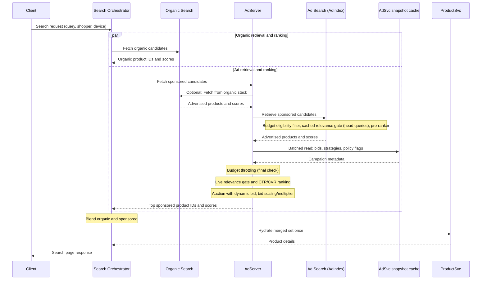
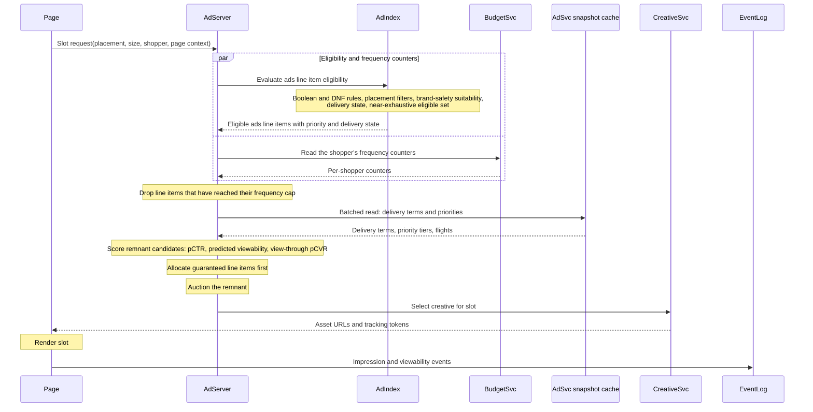
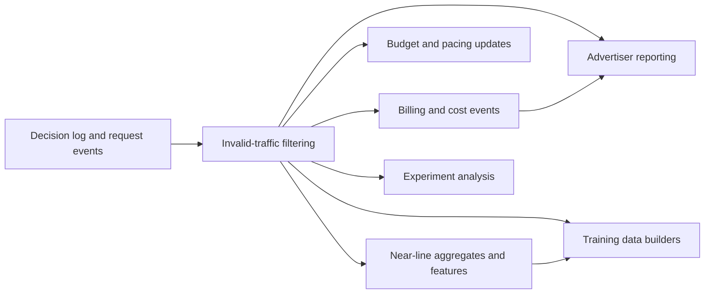
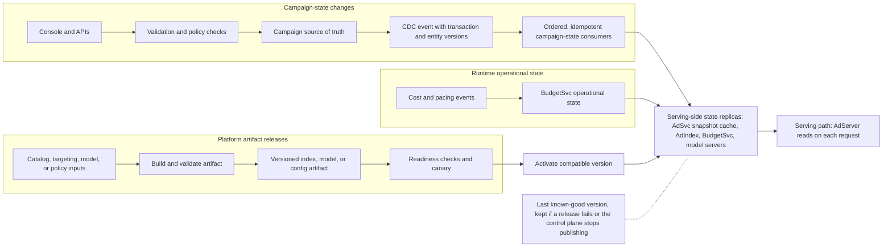

# Part II: The Serving Stack

# Chapter 3: Ad Serving Architecture

An RMN serves ads under a harder constraint than most distributed systems: every decision has to be both fast and economically correct. The platform has to decide which ads participate and which remain eligible after budget and policy checks. It also has to decide how much evidence the ranking models can consume before the deadline expires, and how the final decision is assembled into something the shopper can actually see. Those steps happen inside one online path, but they are sustained by a second path that is just as important: the control plane that turns advertiser, catalog and policy changes into the serving state that the online path reads.

This chapter makes that serving path concrete. It walks two typical request flows in detail: search-integrated placements that must return inside a search page deadline, and display placements that start from a slot rather than a query. Other placements, including sponsored-products modules on item and home pages, are covered by notes rather than full flows. Throughout the chapter, sponsored products remain the primary example. Display differences appear exactly where the architecture changes: how requests are triggered, what the candidate unit is, how guaranteed commitments are honored, what is rendered and which feedback signals dominate.

Four design decisions shape the whole path: how the request deadline is split across stages (Section 1.4), which service holds which state and how fresh that state must be (Section 2), which dependencies fail open and which fail closed (Section 5.1), and how quickly each kind of change must reach serving (Section 4.5). Settle those four first, because most other choices in the chapter, such as which fallback a placement uses, follow from them.

This chapter opens Part II, which follows one ad request through the serving stack in order. Chapter 3 lays out the whole path: the request flows, the stage budgets of **Table 3.3**, the services and the control plane. Each later chapter opens one stage and works inside the budget and the service contract set here:

- Chapter 4, Ads Retrieval: the AdIndex retrieval paths, eligibility filtering and the pre-ranker, inside the 15 ms retrieval envelope.
- Chapter 5, Ranking Models: the relevance gate and the CTR/CVR model, inside the 20 ms ranking stage.
- Chapter 6, Auction and Cost Tracking: ranking and pricing inside the 5 ms auction step, and the cost events that feed billing.
- Chapter 7, Budget Pacing and Spend Control: the budget state that BudgetSvc holds and the pacing that decides which campaigns enter each auction.
- Chapter 8, Ads and Organic: the blending of ads into the page under the ad-load policy.

Bid setting, including dynamic bidding and bid scaling with a budget multiplier, is covered in Chapter 9 in Part III.

---
<details>
<summary>Table of Contents</summary>

- [1. Request Flows and the Latency Budget](#1-request-flows-and-the-latency-budget)
  - [1.1. Search-Integrated Sponsored Placements](#11-search-integrated-sponsored-placements)
  - [1.2. Display Placements: What Changes](#12-display-placements-what-changes)
  - [1.3. Architectural Implications](#13-architectural-implications)
  - [1.4. The Latency Budget](#14-the-latency-budget)
  - [1.5. Scale and Fleet Sizing](#15-scale-and-fleet-sizing)
- [2. Core Components of the Serving Path](#2-core-components-of-the-serving-path)
  - [2.1. AdServer](#21-adserver)
  - [2.2. FeatureStore](#22-featurestore)
  - [2.3. AdIndex](#23-adindex)
  - [2.4. ML Inference Service](#24-ml-inference-service)
  - [2.5. BudgetSvc](#25-budgetsvc)
  - [2.6. AdSvc Snapshot Cache](#26-adsvc-snapshot-cache)
  - [2.7. CreativeSvc](#27-creativesvc)
  - [2.8. ProductSvc and Retail Signals](#28-productsvc-and-retail-signals)
- [3. Feedback Loops: From Serving to Learning](#3-feedback-loops-from-serving-to-learning)
  - [3.1. Logging at the Point of Decision](#31-logging-at-the-point-of-decision)
  - [3.2. One Event Stream, Several Clocks](#32-one-event-stream-several-clocks)
  - [3.3. Monitoring and Controlled Change](#33-monitoring-and-controlled-change)
- [4. The Control Plane: From Campaign Setup to Serving](#4-the-control-plane-from-campaign-setup-to-serving)
  - [4.1. Control Plane and Data Plane](#41-control-plane-and-data-plane)
  - [4.2. Advertiser APIs and Campaign Validation](#42-advertiser-apis-and-campaign-validation)
  - [4.3. Catalog Sync and Eligibility](#43-catalog-sync-and-eligibility)
  - [4.4. Ad Review](#44-ad-review)
  - [4.5. Propagating Changes to Serving](#45-propagating-changes-to-serving)
  - [4.6. Budget and Delivery Configuration](#46-budget-and-delivery-configuration)
- [5. Operating the Serving Path](#5-operating-the-serving-path)
  - [5.1. Failure Handling and Graceful Degradation](#51-failure-handling-and-graceful-degradation)
  - [5.2. Observability and Safe Rollout](#52-observability-and-safe-rollout)
- [6. Design Decisions and Trade-offs](#6-design-decisions-and-trade-offs)
- [Summary and Next Steps](#summary-and-next-steps)
- [References and Further Reading](#references-and-further-reading)

</details>

---

## 1. Request Flows and the Latency Budget

Every request flow in this chapter runs through the same ranking cascade introduced in Chapter 1, Section 6: retrieval, merge and eligibility, pre-ranking, relevance gating, full CTR/CVR scoring, auction and page decision. What changes by placement type is not the existence of the cascade but its trigger, deadline and candidate semantics. A search page begins with a query and competes with an organic ranking stack for the same deadline. A display placement begins with a slot and must honor delivery and frequency constraints before it behaves like an auction. Standalone sponsored placements on item and home pages use the same sponsored-products path as search-integrated placements, but usually with asynchronous module loading and a looser page budget. Those differences are large enough to matter, but they do not justify three unrelated serving architectures.

### 1.1. Search-Integrated Sponsored Placements

Search-integrated sponsored products are stricter because they share a single page deadline with organic search. A shopper enters "wireless headphones" and expects one result set, not two independently timed systems that the browser later stitches together. In the common architecture, the search orchestrator calls the organic search stack and the ad server in parallel. The orchestrator then blends the ad candidates and organic results under one page policy. That ad call therefore has to return inside the organic page budget rather than merely inside the ad module's own budget.

A single request makes the cascade concrete. The shopper's query reaches the ad server with the search page's deadline already set. Retrieval merges its paths into roughly 3,000 advertised products, and the pre-ranker cuts that to about 300 inside AdIndex's 15 ms envelope. The relevance gate and the CTR/CVR model share the 20 ms ranking stage: the gate removes off-topic products, leaving about 200, and the model passes the top 30 or so to the auction. The auction fills the six sponsored slots on the grid page, all inside the 60 ms p99 budget of **Table 3.3**. The orchestrator then blends the winning IDs with organic results and hydrates the merged set once.

Sponsored-products modules on item and home pages still follow the same sponsored-products path, with two practical differences. They are usually loaded asynchronously rather than as part of the main page response, so a late ad response leaves the module empty instead of delaying the page. They also compete with organic recommendation modules for page space, which Chapter 8 picks up when it covers page arbitration.

**Figure 3.1: Search-Integrated Request Flow with Parallel Organic Search and Ads**



> **Dependencies (not shown):** budget throttling reads leased budget state from BudgetSvc (Chapter 7), and the dynamic bid with bid scaling comes from the bidder (Chapter 9). The live relevance gate and CTR/CVR scoring run in the ML Inference Service (Section 2.4), which AdServer calls.

The parallel fan-out is why the reference RMN gives the ad server a 60 ms p99 on search. If the ad stack misses, the page must still ship. Dean and Barroso describe this kind of graceful degradation explicitly: web-search systems can skip results from ads if they do not respond in time [2]. That fallback is a deliberate admission that an on-time organic page is better than a late page with monetization.

Evidence from web search shows why the page deadline matters. Google's latency experiments found that injecting extra delay after ads reduced the daily number of searches per user, with a 200 ms post-ads delay reducing usage by about 0.30% over four weeks [1]. The lesson for RMNs is not that every retailer search page must mimic Google's scale, but that latency debt compounds at the page level even when the delay is small enough that each request still feels "close" to instant.

Search also changes the response contract. The ad server should return more ads than the page ultimately renders. The extra headroom lets the **blender** remove duplicates, reject policy conflicts and apply fixed-position or more dynamic interleaving rules without making a second call to retrieval. Fixed-position interleaving remains the simplest policy to explain: put ads in predetermined locations and fill those locations with the highest surviving sponsored results. It is simple, debuggable and easy to replay offline. Chapter 8 expands the policy ladder from there.

The orchestrator should hydrate products only once, after ads and organic results are merged. That "IDs first, details later" pattern prevents duplicate catalog fetches and lets ProductSvc fetch one batch. It also keeps the ad stack from doing work that the page may later discard. If the retailer instead makes the ad server assemble fully rendered results before interleaving, it spends latency budget on items that the blender may never place.

One architectural decision belongs next to this flow even though Chapter 4 owns the implementation details: ad retrieval can run as a separate sponsored index, or it can reuse the organic search retrieval set in a **piggyback retrieval** design. The separate design gives tighter control over ad recall, eligibility and candidate quotas. The piggyback design reuses query understanding and lexical infrastructure already built for organic search. The consequence is the same either way: whichever option the retailer chooses, the search orchestrator still needs one ad deadline and one blending step.

> **Design trade-off: server-side insertion vs. asynchronous client-side ad calls.** Server-side composition gives one coherent response and no late layout changes, but it places the ad decision on the page's critical path. Asynchronous client-side calls isolate page latency and support lazy module loading, but they add a second round trip and require explicit fallback behavior. Search pages usually justify server-side composition. Item and home modules usually justify asynchronous calls.

### 1.2. Display Placements: What Changes

Display requests begin from a placement, not a query. The page knows that a slot exists, its size and where it is likely to appear relative to the viewport. The request therefore carries placement metadata, page context, shopper identity if available and sometimes a viewability or lazy-load trigger, but it does not begin with a search string. That difference changes the retrieval problem, the priority rules, the rendering path and the dominant feedback signal.

**Figure 3.2: Display Placement Request Flow from Viewport Trigger to Viewability Event**



> **Dependencies (not shown):** BudgetSvc appears here only for frequency-cap counters. Its budget state and pacing (Chapter 7) and the bidder that supplies dynamic bids and bid scaling for the remnant auction (Chapter 9) are not drawn.

The first architectural difference is that display retrieval is usually near-exhaustive over a much smaller corpus. The candidate unit is an **ads line item**, not an advertised product. In the reference RMN, the online line-item corpus is around ten thousand active entries, far smaller than the multi-million sponsored-products corpus. Because guaranteed delivery depends on not silently dropping eligible lines, the serving path cannot truncate display retrieval the way it truncates sponsored-products retrieval. It must, at minimum, return every eligible guaranteed line item and generally every eligible remnant line item as well.

The second difference is that delivery commitments can outrank bids. A guaranteed line item may have to deliver an impression goal during its flight. That means the ad server usually allocates guaranteed demand first, often by priority tier and forecast-backed pacing rules, before the auction consumes the **remnant inventory**, the impressions not committed to guaranteed deals. Licensed display ad servers implement this with priority classes that rank guaranteed line items above remnant demand, and with dynamic allocation, which lets remnant demand win only when it exceeds the guaranteed line item's opportunity cost [3][4]. The exact allocation policy is the subject of Chapter 16.

The third difference is frequency and delivery state. Sponsored products care mainly about spend state and per-request relevance. Display also cares about how often this shopper has already seen the line item, whether the placement belongs to a reserved sponsorship, and whether the slot size matches an available creative. Those checks are lightweight enough to stay in the serving path but important enough that they must happen before final selection. BudgetSvc therefore owns not only spend-facing budget state but also the counters used for frequency caps on display.

The fourth difference is rendering. Sponsored products are usually assembled from catalog data: title, image, price, stock and retailer-owned tile chrome. Display typically returns asset URLs, slot-compatible creative metadata, and tracking tokens. Because many display slots are below the fold, the client often requests them lazily as they approach the viewport. Google's publisher-tag guidance frames lazy loading in exactly those terms: defer requesting and rendering ads until the slot nears the viewport, both to reduce contention and to improve viewability [6]. Once the creative renders, the browser, not the ad server, becomes the authoritative observer for viewability and similar client-side events; the Intersection Observer API is a standard mechanism for detecting that visibility asynchronously [5].

> **Sidebar (as of October 2026): How a licensed display ad server orders demand.** Google Ad Manager documents numeric line-item priorities in which lower numbers mean higher priority. Sponsorship and Standard line items are guaranteed; Price Priority and related classes are remnant demand [3]. Its ad-selection white paper then explains dynamic allocation, where remnant demand competes against the opportunity cost of guaranteed line items without breaking their delivery goals [4]. The durable lesson is the separation between delivery commitments and auction demand, not the vendor-specific numbering.

**Table 3.1: What Changes for Display, Component by Component**

| Component | Sponsored products | Display placements |
|---|---|---|
| AdIndex | Retrieves advertised products by relevance | Evaluates ads line item eligibility near-exhaustively |
| BudgetSvc | Spend state and budget participation | Spend state plus frequency counters and delivery state |
| AdSvc snapshot cache | Bids, strategies, policy flags | Delivery terms, priority tiers, flight and sponsorship data |
| CreativeSvc | Assembles native tiles from catalog data | Selects slot-compatible assets and returns URLs |
| ProductSvc | Hydrates live price, stock, fulfillment | Usually not on the critical path unless contextual retail data is injected |
| Feedback | Clicks, conversions, attributed sales | Impressions, viewability, reach, frequency and eventual post-view effects |

### 1.3. Architectural Implications

All three placement types converge on one point: the retailer should prefer one serving contract with typed differences over one completely separate stack per format, unless the divergence proves operationally unavoidable. The shared contract forces the architecture to keep deadlines, request IDs, experiment assignment and fallback behavior consistent even when retrieval and delivery semantics differ.

**Table 3.2: Request Flows by Placement Type**

| Aspect | Sponsored products on item and home pages | Search-integrated placements | Display placements |
|---|---|---|---|
| Trigger | Page module request | Search results page request | Slot request, often near viewport |
| Primary request key | Context product or page | Query | Placement and page context |
| Candidate unit | Advertised product | Advertised product | Ads line item |
| Typical p99 budget | <= 100 ms | <= 60 ms | <= 150 ms |
| Coordination | Usually asynchronous module load | Shared page deadline with organic results | Slot-level delivery path |
| Final render | Native tile from catalog data | Native tile blended with organic results | Asset or HTML creative in a slot |
| Failure behavior | Empty module or no-fill | Organic-only page | Empty slot or house fallback |

**Code Listing 3.1: Ad Request and Response Contract (illustrative)**

```json
{
  "request": {
    "request_id": "req_01J6...",
    "deadline_ms": 60,
    "client_type": "web",
    "page_type": "search_results",
    "query": "wireless headphones",
    "context_product_id": null,
    "shopper_id": "pseudonymous-shopper-key",
    "experiment_ids": ["exp_arbitration_v2"],
    "placements": [
      {
        "placement_id": "search_grid_top",
        "slot_sizes": ["native_tile"],
        "format_candidates": ["sponsored_product"]
      },
      {
        "placement_id": "search_top_banner",
        "slot_sizes": ["970x250"],
        "format_candidates": ["display"]
      }
    ]
  },
  "response": {
    "request_id": "req_01J6...",
    "decisions": [
      {
        "placement_id": "search_grid_top",
        "format": "sponsored_product",
        "advertised_product_id": "sku123#adgroup456",
        "creative_id": "tile-template-default",
        "pricing_model": "CPC",
        "tracking_token": "signed-auction-token",
        "ttl_ms": 30000
      },
      {
        "placement_id": "search_top_banner",
        "format": "display",
        "ads_line_item_id": "li_8841",
        "creative_id": "creative_7732",
        "pricing_model": "vCPM",
        "tracking_token": "signed-auction-token",
        "ttl_ms": 30000
      }
    ],
    "no_fill_reason": null
  }
}
```

The same contract should also serve new client types. A browser page and a mobile app are the obvious ones, but partner APIs and shopping agents increasingly consume the same decisions in machine-readable form. The request therefore needs to declare a **client type** so ingress, fraud controls and response rendering can differ safely. A browser client may need a renderable tile. An agent client may need structured product data and an explanation field rather than HTML. That variation changes the response envelope, not the existence of the serving stack.

### 1.4. The Latency Budget

The serving path exists because the full decision is too expensive to compute at full candidate volume. The reference RMN therefore assigns p99 budgets to stages, not just to whole requests. Those stage budgets are conservative envelopes rather than literal sums of independent percentiles, but they make the system operable: every service team knows which budget it owns and which levers remain when it starts to drift.

**Table 3.3: p99 Latency Budget by Stage and Placement Type**

| Stage | Search-integrated | Item and home | Display |
|---|---|---|---|
| Request parsing, routing and experiment assignment | 4 ms | 4 ms | 5 ms |
| Query understanding, query embedding and feature fetch (parallel) | 5 ms | 6 ms | 4 ms |
| AdIndex retrieval and eligibility | 15 ms | 15 ms | 20 ms |
| Full-model scoring | 20 ms | 20 ms | 12 ms |
| Auction or guaranteed allocation + auction | 5 ms | 5 ms | 8 ms |
| Creative assembly or selection | 6 ms | 10 ms | 20 ms |
| Network, serialization and slack | 5 ms | 40 ms | 81 ms |
| **Total p99 budget** | **60 ms** | **100 ms** | **150 ms** |

Budgets are p99 at the ad-server boundary. The blender (≤ 5 ms) and product hydration run in the search orchestrator after the ad response, outside the 60 ms; on search, the ad server assembles only tile metadata. Display has no query understanding, so its 4 ms covers the shopper and context feature fetch and the frequency-counter read, which runs in parallel with it. Display's 20 ms AdIndex envelope includes the near-exhaustive line-item eligibility pass, of which Boolean eligibility is ≤ 8 ms (Chapter 4).

The budget is conservative in two ways. First, stage p99s do not literally add. A request that hits the p99 of every stage at once is rarer than the stage budgets suggest. Second, many calls happen in parallel, so the request is bounded by the slowest parallel branch rather than by the sum of every branch. Those two facts are exactly why operators get misled by average latency. Parallel fan-out amplifies tails, not means.

Dean and Barroso quantify the fan-out effect with a simple probability model [2]:

$$
P(\text{slow}) = 1 - (1 - q)^n
\tag{3.1}
$$

where $q$ is the probability that one branch is slow and $n$ is the fan-out width. Their canonical example uses 100 servers, each with only a 1% probability of a one-second outlier, and shows that 63% of end-user requests then experience the slow path [2]. The same math matters at a smaller scale inside an RMN. If five retrieval or scoring branches each have a 1% tail beyond their internal target, almost 5% of user requests see at least one branch miss. That is why an overall p99 target often implies tighter per-branch targets such as p99.8.

The latency levers follow a predictable order. The cheapest fix is to cut work before the expensive model, usually by shrinking candidate counts at the pre-ranker or by using cached head-query relevance scores. The next lever is to move repeated computation out of the request: precompute item-side embeddings, cache line-item targeting expansions or reuse a query embedding across retrieval and ranking. Only after those options are exhausted should the system reach for heavier measures such as hedged requests, aggressive batching changes or a wider budget envelope. Pinterest's ads stack publicly describes the same family of ranking levers, including GPU serving, quantization and distillation [7].

Meta's Andromeda write-up provides the other half of the intuition: retrieval processes three orders of magnitude more ads than the later stages, then narrows them to a few thousand relevant candidates before subsequent ranking stages take over [8]. The cascade exists because cost per candidate rises sharply at each stage. A few milliseconds spent early to reduce the pool can buy tens of milliseconds later by keeping expensive models off the long tail.

> **Design trade-off: fixed per-stage budgets vs. deadline-aware adaptive stages.** Fixed budgets are predictable, replayable and easier to reason about in experiments. Adaptive stages that shrink candidate counts when a request is running late can protect p99 under load, but they make outcomes depend on runtime conditions and complicate offline replay. Most RMNs should start with fixed budgets and treat adaptive truncation as a controlled degradation step rather than as the default path.

### 1.5. Scale and Fleet Sizing

The reference RMN's peak design point is 50,000 ad requests per second. Not every request hits the heaviest path, but the fleet still has to size against the peak work envelope, not the daily average. Fleet sizing begins with a simple throughput relation:

$$
N = \rho_{\text{region}} \cdot \frac{\lambda_{\text{peak}} \cdot w}{c \cdot u}
\tag{3.2}
$$

where $\lambda_{\text{peak}}$ is peak request rate, $w$ is work per request, $c$ is per-instance capacity, $u$ is target utilization, and $\rho_{\text{region}}$ is a regional redundancy factor. The exact units differ by service. For retrieval, work may be requests per second. For GPU ranking, it may be scored candidates per second. For event consumers, it may be events or rows processed per second.

Apply this estimate separately to each capacity pool, using that component's own arrival rate, work per arrival, measured per-instance capacity and target utilization. Do not copy the ad-request rate into every service: ranking demand scales with candidates scored, ProductSvc demand with batched hydrations and event-consumer demand with events or candidate rows. Where a request fans out to several instances, size against the per-instance share of that work and validate the result against measured queueing and p99 latency.

**Table 3.4: Fleet Sizing at the Reference RMN's Design Point**

| Quantity | Design point | Notes |
|---|---|---|
| Peak ad requests | 50K/s | Reference RMN registry |
| Average ad requests | 15K/s | Rough seasonal average for capacity planning |
| Retrieved candidates entering full ranking | ~300/request | After pre-ranking |
| Peak scored candidates | ~15M candidate scores/s | 50K/s x 300 |
| Peak served-impression events | ~300K/s | Depends on placements rendered per page |
| Candidate-row decision logs at full fidelity | ~15M rows/s | Motivates sampled loser logging |
| AdServer capacity per instance | ~1K requests/s | Reference-RMN assumption |
| AdIndex capacity per replica | ~2.5K requests/s | Reference-RMN assumption; Chapter 4 uses this figure |
| Ranking capacity per GPU | ~100K candidate scores/s | Reference-RMN assumption; Appendix 2 measures against its model |
| Regional redundancy factor | 2x | One region degraded while another absorbs traffic |
| Target utilization | 60 to 70% | Leaves headroom for burst and failover |

Evaluated with the table's 2× redundancy and 65% utilization (the midpoint of 60–70%), Equation 3.2 gives the fleet at peak. The AdServer needs about 2 × 50,000 ÷ (1,000 × 0.65) ≈ 154 replicas. AdIndex needs about 2 × 50,000 ÷ (2,500 × 0.65) ≈ 62 replicas. GPU ranking needs about 2 × 15,000,000 ÷ (100,000 × 0.65) ≈ 460 GPUs. These are planning figures, not live counts.

Autoscaling changes the replica count over time; it does not change the sizing relationship. A reactive controller can recalculate desired capacity from a short-window load estimate, but the fleet must already have enough warm capacity to absorb demand during metric delay, instance startup, model loading and traffic shifts. Keep minimum replicas for baseline load, cap scale-out at tested capacity and use a forecast or scheduled pre-scaling for known peaks. The regional redundancy factor is separate: it reserves capacity for failover and should not be mistaken for ordinary autoscaling headroom. Validate scale-up and scale-down policies under load, since aggressive scale-down can remove headroom just before a burst and scaling GPU workers too late may not protect the current p99.

Those figures clarify why statelessness is helpful but not sufficient. AdServer and most ML inference replicas scale horizontally. But AdIndex replicas, feature stores, event logs and distributed counters also need replication and partitioning strategies that keep their own latency inside the envelopes above. Chapter 4, Chapter 5, Chapter 7 and Appendix 1 explain how the heaviest services meet these budgets.

---

## 2. Core Components of the Serving Path

The serving stack is easiest to reason about as one orchestrator and a small number of specialized services. The orchestrator owns the request deadline, experiment assignment and final decision. The specialized services own state and computation that would otherwise create hidden coupling if it were embedded inside one giant process. **Table 3.5** is the architectural anchor for the chapter.

**Table 3.5: Serving Components: Ownership, State, Freshness, Scaling and Fallback**

| Component | Primary responsibility | State it owns or reads | Freshness target | Scaling unit | Fallback when impaired |
|---|---|---|---|---|---|
| AdServer | Orchestration, deadlines, final decision and decision-log emission; supplies request IDs and decision data used by billing and measurement joins | Request-scoped state only | Immediate | Stateless replicas | Degrade to simpler decision path or no-fill |
| FeatureStore | Online shopper and context features | Cached online features, embeddings | Seconds to minutes by feature tier | Partitioned online store | Default features or cached last-known values |
| AdIndex | Retrieval, eligibility, pre-ranking | Index snapshots, targeting structures | Seconds for urgent state; minutes for rebuilds | Replicated or sharded index services | Smaller candidate set, cached head results, no-fill |
| ML Inference Service | Relevance and CTR/CVR scoring | Loaded model weights and calibration tables | Canary to full rollout over minutes to hours | CPU or GPU inference replicas | Pre-ranker order or cached scores |
| BudgetSvc | Budget and frequency state | Spend and pacing state, leases; per-shopper frequency counters (sharded key-value) | Seconds | Partitioned state service | Bounded fail-open or fail-closed by dependency |
| AdSvc snapshot cache | Campaign metadata and delivery terms | Propagated snapshots, policy flags | Seconds to minutes | Read cache over source of truth | Use last good snapshot |
| CreativeSvc | Sponsored-tile assembly or display creative selection | Templates, asset metadata | Seconds to minutes | Stateless replicas backed by CDN | Empty slot, house creative, or no-fill |
| ProductSvc | Live retail signals and hydration | Price, stock, margin, fulfillment | Mixed: sub-minute to near-live | Shared retail service | Omit stale values or suppress item |

### 2.1. AdServer

AdServer is the orchestrator. It parses the request, assigns experiments, stamps one absolute deadline onto the request and passes that deadline to every downstream call. Google SRE literature describes the rationale directly: the request should carry one deadline from the top of the stack so that downstream services can stop work when success is already impossible [9]. Without that propagation, each dependency tunes for its own timeout instead of the user's deadline.

AdServer should also enforce two defensive rules. First, retries happen at one layer only. Brooker shows why: five service layers each retrying three times can amplify load 243-fold on the terminal dependency [10]. In the serving path, that is enough to turn a slow backend into a cascading failure. Second, hedged requests are reserved for idempotent reads with large tail variability, such as replicated feature or index reads, not for mutating operations or auction decisions.

The service decomposition also gives AdServer one clean performance job: keep the critical-path logic on CPU and delegate specialized state or heavy compute outward. It should compute or fetch the query embedding once, then pass it to whichever retrieval and scoring stages need it, rather than asking every downstream component to derive the same representation independently. Appendix 1 turns that principle into a concrete interface.

> **Design trade-off: one orchestrator vs. a chain of peer services.** A central orchestrator keeps deadlines, fallbacks, experiment assignment and logging in one place. A peer chain can remove one hop, but it spreads ownership of those policies across teams and makes graceful degradation harder to keep consistent. Most RMNs should centralize orchestration and split out only the compute-heavy or state-heavy services.

### 2.2. FeatureStore

FeatureStore serves the online shopper, context and lightweight session features that retrieval and ranking need. Its job is to provide those features inside a tiny p99 budget, usually only a few milliseconds, and to do so with semantics that later make training and serving comparable, not merely to hold them. Google's Rules of Machine Learning frame the key discipline clearly: the safest way to train like you serve is to save the actual features used at serving time and log them for later learning [11]. That is why the feature store and the decision logger are coupled conceptually even if they run as separate systems.

Online features are therefore only half of the story. The more important contract is provenance: which feature version was read, which default was applied and whether the feature was stale or missing. Chapter 5 covers model-facing feature design. The operational fact that matters here is that the store's latency and freshness targets directly constrain what the ranking models are allowed to depend on.

> **Design trade-off: request-time features vs. precomputed features.** Request-time features are fresher but add a tail-sensitive call. Precomputed features are cheap at serving time but stale by construction. Most RMNs precompute item-side features, keep slowly changing shopper aggregates online and reserve true request-time computation for the narrowest context signals.

### 2.3. AdIndex

AdIndex owns candidate generation and eligibility. For sponsored products, that means multiple retrieval paths, merge logic, hard eligibility filters and a pre-ranker that returns roughly 300 survivors tagged by format. For display, it means near-exhaustive line-item eligibility evaluation rather than top-K relevance truncation. The important boundary is that AdIndex does not own the final ranking model. It owns the fast reduction from millions or thousands of possible candidates to a bounded candidate set that later stages can afford.

AdIndex's envelope is ≤ 15 ms p99. It contains whatever parallel retrieval paths the service needs, and those paths run concurrently, so the envelope is not the sum of every internal sub-stage. Chapter 4 explains those internal paths. Appendix 1 explains their implementation, update tiers and sharding.

### 2.4. ML Inference Service

The ML inference tier hosts the relevance model and the CTR/CVR model that Chapter 5 develops. Operationally, it is a stateless fleet that loads versioned models from a registry, batches requests when advantageous and surfaces the exact model version and calibration data used on each decision. The reason for a separate inference tier is throughput isolation, not fashion. Ranking models evolve faster than the rest of the serving stack, and they often require different hardware economics.

Server-side dynamic batching is the canonical example. NVIDIA's Triton documentation describes the core trade-off: combine compatible inference requests on the server to raise throughput, bounded by a maximum queue delay so the request still fits its latency budget [12]. In practice, that means the queue-delay knob becomes one of the few explicit controls the serving team has over latency-versus-throughput behavior. A larger batch can raise GPU efficiency while still hurting p99 if the queue delay consumes too much slack.

> **Sidebar (as of October 2026): Model-serving frameworks age faster than architecture.** Triton remains a strong reference for server-side dynamic batching and queue-delay control [12]. TorchServe, by contrast, now carries a limited-maintenance notice and no longer promises active fixes or security updates [13]. The durable design lesson is to isolate inference behind a stable contract so the runtime can change without rewriting the serving stack.

> **Design trade-off: GPU vs. CPU inference for ranking.** GPUs excel once the relevance and CTR/CVR models are large enough that batching amortizes the cost, but they introduce queueing delay and higher instance cost. CPUs remain attractive for small models and pre-rankers. A Stage 1 RMN can begin with CPU ranking; a Stage 2 platform usually graduates to GPU-backed full ranking.

### 2.5. BudgetSvc

BudgetSvc owns budget participation state. For sponsored products, that primarily means spend state, pacing leases and exhaustion signals. For display, it also means frequency counters and, in some architectures, delivery-state checkpoints used to protect guaranteed campaigns. The service should not sit on the critical path as a heavy remote transaction. Instead, Chapter 7's architecture moves most of the online decision into locally cached or leased state so that eligibility is effectively a lookup bounded by tight refresh windows rather than a global lock or strongly consistent write.

That design is the only way to keep the serving path inside the latency budget while still letting cost events update state within seconds. The operational consequence is that BudgetSvc rarely provides a perfect global truth in the instant of decision. It provides truth that is correct within bounded staleness, and that exposure has to be understood and limited.

The frequency counters follow the same rule of staying off the critical path. Each display request reads the shopper's counter record once at request start, in parallel with the shopper-feature fetch (**Table 3.3**), and the AdServer drops capped line items before scoring. Chapter 16, Section 5 covers the counter store and the cap policy.

### 2.6. AdSvc Snapshot Cache

The AdSvc snapshot cache holds the campaign fields that serving needs for every active ad group and ads line item: bids, bid strategies, policy flags and display delivery terms. It is an out-of-process, replicated in-memory cache in each region. The control-plane campaign store remains the source of truth and feeds the cache through the campaign-state path of Section 4.5, so the serving path never calls the store. A new cache replica first loads a versioned full snapshot and then replays the change stream from that snapshot's offset, so it never serves a partial view.

On each request, the AdServer issues one batched read for the candidates that retrieval returned. On search requests that read runs in parallel with full-model scoring, so it adds no stage to **Table 3.3**. If the cache is impaired, the AdServer serves from the last good snapshot instead of failing the request, which is the static-stability rule of Section 4.1.

Keeping the snapshot out of process is what lets the AdServer stay stateless (**Table 3.5**). An in-process copy would save one network hop, but it would put the full change stream and a full metadata copy on every AdServer replica, about 154 of them at the reference peak (Section 1.5). A shared cache in each region loads one copy and consumes the stream once.

### 2.7. CreativeSvc

CreativeSvc has two jobs that look similar from far away and different up close. For sponsored products, it assembles the native tile using catalog fields, retailer-owned presentation rules and tracking metadata. For display, it selects a slot-compatible asset, returns CDN-backed URLs or markup, and ensures the rendering metadata matches the placement. In both cases, the budget is small. That is why the service should not perform heavyweight creative generation or policy review online; those belong in Chapter 10's creative pipeline and in the control plane.

Operationally, CreativeSvc is also where the no-fill policy becomes visible. If the auction selected a winner but the winning creative cannot render safely for the slot, the service needs a deterministic fallback: empty slot, next ranked creative or house fallback, depending on the placement type.

### 2.8. ProductSvc and Retail Signals

ProductSvc is where the RMN's advantage becomes operational. The service hydrates winner SKUs with live retail facts such as current price, stock, fulfillment promise and sometimes margin or offer-eligibility signals that later chapters use in arbitration. Sponsored products need this data because a native tile is a retail object, not just an ad impression. Item-page modules use them to ensure the sponsored item is still purchasable at the moment it is shown.

Some retail signals are eligibility-critical. If an item is out of stock or loses offer eligibility, the advertised product should be suppressed before it reaches auction, inside the ≤ 1 min tier of **Table 3.6**. Other values, such as current price, can be read live at assembly time. The durable lesson is that serving has to know which retail facts are hard gates and which are presentational enrichments.

> **Sidebar (as of October 2026): Retail signals can override monetization.** Amazon's public advertiser documentation states that Sponsored Products do not display when an advertised item is out of stock or not the Featured Offer [14][15]. That policy is specific to one platform, but the architecture it implies is general: some retail states invalidate an ad even if its bid and relevance are strong.

---

## 3. Feedback Loops: From Serving to Learning

An ad-serving architecture is complete only when the system can explain later why that winner appeared, bill the correct party, update budget state, train new models and detect when the whole mechanism starts drifting. Merely returning a winner is not enough. The point of the event loop is accountability across several clocks, not simple observability.

### 3.1. Logging at the Point of Decision

The most important event in the system is the decision itself. AdServer should mint one request ID and attach it to the decision log and to downstream events such as rendered impressions, clicks, conversions and experiment assignments. AdServer emits the decision context; event producers and consumers handle later validation, billing, attribution and reporting. Facebook's ads prediction architecture uses the same request-ID idea in its online joiner, where impressions and clicks are joined primarily on the request identifier [16]. Without that key, later stages guess which events belong together.

The decision log should include the features actually used at serving time, the model versions and calibration tables that produced the scores, candidate counts at each ranking stage, the winning price or cost basis and the experiment bucket. Record every candidate that reaches the auction, including winners and losing finalists, with the scores and eligibility state used for the decision. Google's Rule #29 exists because teams routinely underestimate how much skew and debugging pain disappears when those serving-time features are logged explicitly [11].

At the reference RMN's peak, full-fidelity logging of every candidate scored by the ranking models would produce on the order of 15 million candidate rows per second. That is too expensive to treat casually. Log the much smaller set of auction finalists in full, log lightweight stage summaries for every request and sample candidates discarded before the auction with explicit sampling probabilities. This preserves the exact competition that produced each auction result while keeping earlier-stage logging bounded; downstream counterfactual evaluation must account for the recorded sampling probabilities.

> **Design trade-off: log all auction finalists vs. sample earlier candidates.** Logging every candidate scored by the ranking models preserves the most detail but can reach millions of rows per second. Logging all auction finalists preserves the exact set that competed for the impression; sampling candidates discarded earlier controls volume, provided their sampling probabilities are recorded and respected in offline evaluation.

### 3.2. One Event Stream, Several Clocks

The same event stream feeds several consumers that care about different latencies. A billing or pacing consumer may need updates within seconds. A near-line feature job may tolerate minutes. A training-data builder may operate hourly or daily. Kafka's durable event-log model captures the architecture well: multiple independent consumers can subscribe to the same event stream and process it on their own clocks [17].

**Figure 3.3: Serving-to-Learning Feedback Loop on One Event Stream**



Invalid-traffic filtering happens early because every downstream consumer would otherwise learn or charge from bad traffic. Chapter 12 expands the fraud machinery. After that filter, the clocks diverge. Google's Photon system joined search queries and ad clicks for billing and advertiser reporting with average end-to-end latency under ten seconds while still aiming for exactly-once semantics eventually [18]. Facebook's ads joiner surfaces a second constraint: the waiting window for clicks is a trade-off between fresher labels and more buffering memory [16]. DoorDash's ad-events architecture gives the retail-media version of the same story, with billing, attribution and budget consumers all reading the shared stream and using idempotent writes to tolerate at-least-once delivery [19].

Display requests skew the loop toward impressions, viewability and reach, while sponsored products skew it toward clicks and sales. That does not justify two separate event architectures. It just means the consumers emphasize different metrics. The billing and pacing path for sponsored products will react heavily to click-driven cost events. The display path will also care about whether the impression was viewable and whether a frequency cap is approaching exhaustion.

### 3.3. Monitoring and Controlled Change

Monitoring should not stop at uptime graphs. The serving stack needs operational metrics and behavioral metrics. Operationally, it tracks per-stage p50 and p99 latency against **Table 3.3**, timeouts, error rates, queue delay in the inference tier and no-fill rates by placement type. Behaviorally, it tracks fill rate, effective CPM, calibration drift between predicted and observed click-through behavior and the distribution of degradation modes. When those metrics move, the system needs safe rollback hooks. A shared platform should treat model, config and auction changes alike: staged rollout first, then broader exposure once monitoring remains inside guardrails.

---

## 4. The Control Plane: From Campaign Setup to Serving

The online path can only be fast because another path has already validated inputs, joined them with catalog and policy state, compiled targeting and distributed snapshots to the serving fleet. The control plane owns that preparatory work. Its design goal is safe, predictable state change, not low-latency request serving.

### 4.1. Control Plane and Data Plane

AWS's Builders' Library offers the clearest vocabulary for this split: the control plane is the machinery that makes changes to a system, while the data plane is the machinery that performs the system's daily business [20]. In an RMN, the data plane is the serving path we just described. The control plane includes the advertiser console and APIs, validation services, ad review, campaign stores, catalog joins and the publishers that distribute serving snapshots.

The separation matters because the planes fail differently. The data plane must keep serving from its last good state even when the control plane is impaired. Static stability is the design principle: if the control path cannot publish new state, the serving path keeps working on existing state rather than depending on live control-plane availability [20]. Facebook's configuration system illustrates the same principle in concrete form: config clients can fall back to an on-disk cache even if the central configuration components fail [21].

### 4.2. Advertiser APIs and Campaign Validation

Advertisers and internal operators both need APIs that feel immediate rather than batch-oriented. The control plane therefore performs synchronous validation on the write path before a change enters serving: schema checks, budget sanity, targeting compilation, policy pre-checks and the basic retailer-specific eligibility checks that can fail fast. Validation should reject obviously broken configuration before it becomes a noisy incident rather than run the whole serving stack.

That rule is especially important for self-serve systems. A managed-sales organization can hide some operational rough edges behind human process. A self-serve advertiser interprets any multi-minute or opaque validation cycle as product instability. The control plane therefore has a user-experience obligation of its own even though it is not on the shopper request path.

### 4.3. Catalog Sync and Eligibility

Catalog changes happen at a much larger scale than ad-serving changes, but only a tiny fraction of the full catalog is usually advertised. The control plane should therefore join catalog churn against the advertised subset and propagate only the resulting ad-serving deltas. Out-of-stock transitions, offer loss, restricted-product flags and similar eligibility changes need to reach serving within the ≤ 1 min tier of **Table 3.6**, because showing an ineligible item is a trust failure, not merely a stale metric.

Price changes behave differently. They matter for the final rendered tile, but they rarely require a full index rebuild if the ranking decision itself does not depend on the exact current price. That is why ProductSvc can own some live retail enrichments while the control plane owns the hard eligibility state.

### 4.4. Ad Review

Ad review is explicitly off the serving path. It lives on the control-plane path, where it can inspect creatives, reject prohibited assets and re-review changed material before anything reaches the fleet. The serving system then treats approval status as an already propagated fact.

> **Sidebar (as of October 2026): Review latency belongs in the control plane, not in serving.** Amazon's moderation guidance asks advertisers to submit ads at least a week before launch, notes that translated campaigns can take up to 72 hours, and can remove ads at any time [22]. Those timings are vendor-specific, but the architectural lesson is stable: creative review can take hours or days, so it must complete before the serving path ever sees the line item as eligible.

### 4.5. Propagating Changes to Serving

Propagation covers three related but distinct workflows. **Campaign-state changes** originate in advertiser or operator transactions: pause a campaign, change a bid or block a creative. **Runtime operational state** includes events such as spend exhaustion and pacing updates, which BudgetSvc consumes and publishes through its online state mechanism. **Platform releases** publish derived or system-wide artifacts: rebuild an index, refresh catalog-derived structures or roll out a model, calibration table or policy bundle. Campaign changes usually start as source-of-truth transactions and flow through change data capture (CDC). Operational state follows the budget/event path. Platform releases usually start in a builder or model registry and flow through versioned artifact publication. Treating them as one mechanism either makes urgent updates too slow or makes large releases too unsafe.

**Figure 3.4: Campaign Changes and Platform Releases Propagate to Serving**



On the campaign-state path, change data capture is the boundary between committed system-of-record writes and downstream consumers. Debezium's architecture provides the generic pattern: read database changes from the source log and publish them to downstream topics where specialized consumers can react independently [23]. These events carry campaign mutations to the AdSvc snapshot cache or targeted index updates. CDC may also trigger a rebuild, but the resulting index is a platform artifact and follows the release path after it has been built and validated. Spend exhaustion and pacing feedback are different: cost events update BudgetSvc's operational state, which is then exposed to serving under BudgetSvc's consistency and freshness contract.

Index and model refreshes are not campaign transactions, so the two paths keep serving consistent in different ways. Each campaign mutation carries an entity key and a version. Consumers apply it idempotently and reject older versions, so each entity converges even while different entities progress at different speeds. Indexes, models and configuration ship as versioned artifacts, and a replica activates an artifact only when the complete version is present. Separate services switch on a shared activation epoch only when serving correctness requires their versions to change together. Urgent revocations ride a separately versioned deny overlay, so a slow index rebuild cannot keep prohibited content eligible. Appendix 1 covers the transaction-boundary and activation mechanics.

**Table 3.6: Propagation Paths by Change Scope**

| Change scope | Examples | Typical mechanism | Consistency and rollout | Target p99 to serving |
|---|---|---|---|---|
| Campaign entity mutation | Pause, bid change, hard policy block, out-of-stock or lost offer → ineligible | CDC or catalog-join delta, applied as a per-entity update | Ordered and idempotent per entity; urgent denies may use an overlay | ≤ 10 s for pause, status and hard blocks; ≤ 1 min for bids and out-of-stock |
| Runtime operational state | Spend exhaustion, pacing participation, frequency counters | BudgetSvc cost/event stream and local state publication | Bounded staleness and lease/counter semantics; not a campaign transaction | Budget state ≤ 10 s; counters trail impressions by seconds |
| Campaign-derived targeting update | Targeting change, new advertised product, approved creative | Targeted build, then versioned index artifact | Build from a consistent input version; activate only when complete | ≤ 5 min |
| Platform data/index refresh | Catalog reshape, re-embedding after model changes, full index rebuild | Versioned artifact rollout | Validate, canary, then atomically switch each replica | ≤ 1 h |
| Model/configuration release | Model weights, calibration, feature schema, serving policy, aggregated quality features | Versioned compatible bundle and staged rollout | Canary against guardrails; retain the last known-good bundle | Staged rollout; daily for aggregated quality features |

The targets in the rightmost column are the reference RMN's design values and the book's canonical propagation tiers; later chapters cite this table rather than restating a number.

Facebook's configuration-management paper shows why staged configuration rollout deserves the same engineering respect as code rollout. Their canary system automatically rolls out configs to a subset of production machines, monitors health and rolls back on failure, while also reporting that 16% of the incidents were related to configuration management in one study window [21]. They also report a baseline commit-to-production latency of about 14.5 seconds [21], which offers a plausible public reference point for what "seconds" means in practice. Configuration is software and should ship with the same canary discipline, whatever the exact number.

> **Design trade-off: fast campaign mutation vs. coordinated platform release.** Per-entity updates deliver independent campaign changes quickly, but separate keys may briefly disagree. Versioned artifacts make index and model releases complete, testable and canaryable, but take longer to build and activate. Stream urgent entity changes; publish derived indexes and model/config bundles as releases, coordinating activation only when their compatibility requires it.

### 4.6. Budget and Delivery Configuration

Budgets, schedules, impression goals, sponsorship rules and frequency caps are all authored in the control plane before they become BudgetSvc state. That propagation boundary is easy to forget because Chapter 7 focuses on online pacing loops. The control plane is where those loops get their objectives, caps and initial policies. Guaranteed delivery plans for display follow the same rule: their allocation parameters reach the serving path as already published configuration rather than as live operator input.

---

## 5. Operating the Serving Path

Once the stack is decomposed, the remaining question is how it behaves under stress. The quality bar is that the user-visible outcome degrades deliberately rather than chaotically, not that every dependency stays perfect.

### 5.1. Failure Handling and Graceful Degradation

Google SRE defines a cascading failure as a failure that grows over time through positive feedback [9]. In the ad stack, the loop usually looks like this: one dependency slows down, upstream callers wait too long or retry too aggressively, queues build and the next dependency collapses under multiplied load. Avoiding that spiral requires three habits. First, shed load before the system is fully saturated. Second, stop doing optional work when the deadline is already lost. Third, decide in advance which dependencies fail open and which fail closed.

Yanacek's Builders' Library piece frames the load-shedding principle succinctly: reject excess work so the server can focus on the requests it chooses to let in [24]. In ad serving, that means ingress should be able to drop requests whose deadline has already effectively expired, rather than allowing them to consume scarce ranking or hydration capacity. It also means services should stop work when they can observe that the client has timed out.

**Table 3.7: The Degradation Ladder**

| Step | What it saves | What it costs | Typical trigger |
|---|---|---|---|
| Disable hedged reads | Downstream load | Slightly higher tail latency | Mild backend saturation |
| Shrink candidate counts before full ranking | GPU and feature load | Lower recall | Ranker p99 drift |
| Reuse cached scores for head traffic | Ranking cost | Staler decisions | Hot-key overload |
| Fall back to pre-ranker order | Full-model latency | Lower ranking quality | Inference outage |
| Drop optional modules | Page latency | Lost monetization surface | Broad stack pressure |
| Serve organic-only search or empty slot | Protect core page | Lost ad revenue | Deadline violation or critical dependency loss |

The fail-open or fail-closed decision is a policy choice per dependency. Budget state may justify bounded fail-open behavior because slight overspend is cheaper than blanking the entire page. Frequency caps may justify tighter behavior on sensitive display placements. Ad review and consent checks usually fail closed because stale permissiveness costs trust or compliance. The important point is to write those rules down before an incident forces an improvised answer.

> **Design trade-off: fail open vs. fail closed.** Fail open where bounded staleness costs some money but preserves the shopper experience. Fail closed where permissive serving would violate policy, trust or compliance. Decide per dependency, not once for the whole stack.

### 5.2. Observability and Safe Rollout

The serving path needs distributed tracing by request ID, p50 and p99 latency by stage, timeout and error budgets, fill rate, no-fill reasons and calibration drift. Those metrics tell operators which rung of **Table 3.7** the system is currently approaching and whether a rollout has changed the economics of the stack, not merely its uptime.

Rollout policy should treat code, configuration and models symmetrically: canary first, then staged expansion, with rollback automation tied to the same request-level and business-level guardrails. Dean and Barroso describe canary requests at the tail-mitigation layer [2]. Facebook describes canaried configuration [21]. The common pattern is broader than either source: expose a small slice of live traffic before fan-out becomes expensive.

---

## 6. Design Decisions and Trade-offs

The serving architecture is easier to evolve when its major decisions are explicit rather than hidden inside component defaults. **Table 3.8** collects the chapter's core decisions and the circumstances that usually justify each side.

**Table 3.8: Design Decisions and Trade-offs**

| Decision | Options | What each buys | When to choose it |
|---|---|---|---|
| Page composition path | Server-side insertion vs. asynchronous client-side calls | Server-side preserves one coherent response; async isolates page latency | Server-side for search, async for non-critical modules |
| Display allocation | Strict priority tiers vs. opportunity-cost allocation | Strict tiers are simple; opportunity-cost allocation raises yield | Start with tiers, add opportunity-cost logic once forecasting matures |
| Latency control | Fixed budgets vs. adaptive truncation | Fixed budgets are debuggable; adaptive truncation protects p99 under stress | Fixed by default, adaptive as a degradation step |
| Orchestration | Central AdServer vs. peer chain | Central orchestration keeps deadlines and fallbacks coherent | Prefer central orchestration until scale forces a split |
| Feature freshness | Request-time vs. precomputed | Request-time is fresher; precomputed is cheaper and safer on tail latency | Precompute item-side signals, fetch shopper context online |
| Ranking hardware | CPU vs. GPU | CPU is simpler; GPU handles larger models efficiently | CPU for small models, GPU when full ranking grows |
| Propagation policy | Streaming updates vs. versioned snapshots | Streaming is fast; snapshots are coherent and easier to canary | Stream urgent small changes, snapshot structural ones |
| Dependency posture | Fail open vs. fail closed | Fail-open protects continuity; fail-closed protects policy and trust | Decide per dependency, document it, and test it |
| Decision logging | Full-fidelity logs vs. sampled losers | Full logs maximize analytic power; sampling controls cost | Log all auction finalists in full; sample earlier-stage candidates with recorded probabilities |

By maturity stage, the pattern is predictable. A Stage 1 RMN can begin with one AdServer, one lexical-and-rules AdIndex, CPU ranking and a managed event log. Stage 2 adds GPU-backed full ranking, canaried configuration, sampled decision logs and a deliberate degradation ladder. Stage 3 adds display delivery and guaranteed-allocation behavior on the same stack, plus multi-region discipline. Stage 4 treats API and agent clients as first-class request types and starts tuning the response envelope, not just the browser path.

---

## Summary and Next Steps

An RMN serving architecture is one online path fed by one control plane and closed by one event loop. Sponsored products and display are variations on the same serving discipline, not different businesses hidden behind different boxes. That discipline is candidate generation under a deadline, bounded state freshness, explicit fallback behavior and a control plane that keeps bad changes out of the hot path.

Chapter 4 takes the next step down the stack by opening AdIndex itself: lexical retrieval, embedding-based retrieval, product-to-product retrieval and the display-specific eligibility path.

---

## References and Further Reading

[1] Brutlag, J. (2009). "Speed Matters for Google Web Search." Google. https://services.google.com/fh/files/blogs/google_delayexp.pdf (Accessed October 2026). Reports the effect of added latency on search usage, including a 200 ms post-ads delay experiment.

[2] Dean, J., & Barroso, L. A. (2013). "The Tail at Scale." Communications of the ACM, 56(2), 74-80. https://www.barroso.org/publications/TheTailAtScale.pdf (Accessed October 2026). Explains fan-out tail amplification, hedged requests, canarying, and the principle of skipping ads when they miss a web-search deadline.

[3] Google Ad Manager Help. "Line items." https://support.google.com/admanager/answer/177279?hl=en (Accessed October 2026). Defines line-item types and default priorities for guaranteed and non-guaranteed demand.

[4] Google Ad Manager Help. "Ad selection white paper." https://support.google.com/admanager/answer/1143651?hl=en (Accessed October 2026). Describes dynamic allocation and opportunity-cost comparisons between guaranteed and remnant demand.

[5] MDN Web Docs. "Intersection Observer API." https://developer.mozilla.org/en-US/docs/Web/API/Intersection_Observer_API (Accessed October 2026). Documents browser-side visibility observation, including advertisement viewability use cases.

[6] Google for Developers. "Lazy loading" and "Ad best practices" for Google Publisher Tag. https://developers.google.com/publisher-tag/samples/lazy-loading. https://developers.google.com/publisher-tag/guides/ad-best-practices (Accessed October 2026). Describes viewport-triggered ad requests and why below-the-fold ads are deferred.

[7] Alford, A. (2024). "Unpacking How Ad Ranking Works at Pinterest." InfoQ. https://www.infoq.com/articles/pinterest-ad-ranking-ai/ (Accessed October 2026). Summarizes Pinterest's retrieval, ranking, latency, and ranking-optimization levers.

[8] Sun, C., Yu, N., Lu, H., Wang, L., Pu, Y., Liu, G., Bhatia, N., & Musumeci, G.-P. (2024). "Meta Andromeda: Supercharging Advantage+ automation with the next-gen personalized ads retrieval engine." Engineering at Meta. https://engineering.fb.com/2024/12/02/production-engineering/meta-andromeda-advantage-automation-next-gen-personalized-ads-retrieval-engine/ (Accessed October 2026). Describes large-scale ads retrieval and cascade shrinkage.

[9] Ulrich, M. (2016). "Addressing Cascading Failures." In Site Reliability Engineering. https://sre.google/sre-book/addressing-cascading-failures/ (Accessed October 2026). Covers deadline propagation, graceful degradation, and retry budgets.

[10] Brooker, M. (2019). "Timeouts, retries, and backoff with jitter." Amazon Builders' Library. https://builder.aws.com/content/3EumjoZascWd1oZiEgL8ORlv3qE/timeouts-retries-and-backoff-with-jitter (Accessed October 2026). Explains p99.9-based timeouts, retry amplification, and single-layer retry discipline.

[11] Zinkevich, M. "Rules of Machine Learning: Best Practices for ML Engineering." Google for Developers. https://developers.google.com/machine-learning/guides/rules-of-ml (Accessed October 2026). Especially Rule #29 on logging serving-time features.

[12] NVIDIA. "Dynamic Batcher." Triton Inference Server User Guide. https://docs.nvidia.com/deeplearning/triton-inference-server/user-guide/docs/user_guide/batcher.html (Accessed October 2026). Explains server-side dynamic batching and queue-delay control.

[13] PyTorch. "TorchServe: Notice: Limited Maintenance." https://docs.pytorch.org/serve/README.html (Accessed October 2026). States that TorchServe is no longer actively maintained.

[14] Amazon Ads. "FAQs: Advertising questions and resources." https://advertising.amazon.com/resources/faq (Accessed October 2026). Notes that Sponsored Products do not display when the advertised item is not the Featured Offer or is out of stock.

[15] Amazon Ads. "Best practices for your Sponsored Products ads." https://advertising.amazon.com/library/guides/sponsored-products-best-practices (Accessed October 2026). Confirms that Sponsored Products require in-stock items to remain eligible.

[16] He, X., Pan, J., Jin, O., Xu, T., Liu, B., Xu, T., Shi, Y., Atallah, A., Herbrich, R., Bowers, S., & Quinonero Candela, J. (2014). "Practical Lessons from Predicting Clicks on Ads at Facebook." ADKDD 2014. https://quinonero.net/Publications/predicting-clicks-facebook.pdf (Accessed October 2026). Describes request-ID-based online joins and the waiting-window trade-off.

[17] Apache Kafka. "Introduction." https://kafka.apache.org/intro (Accessed October 2026). Defines the durable event-log model used by multiple consumers on different clocks.

[18] Ananthanarayanan, R., et al. (2013). "Photon: Fault-tolerant and Scalable Joining of Continuous Data Streams." SIGMOD 2013. https://www.cs.albany.edu/~jhh/courses/readings/ananthanarayanan.sigmod13.ha.pdf (Accessed October 2026). Describes stream joins for queries and ad clicks with low end-to-end latency.

[19] Chu, C. (2024). "Building a Large Scale Real-Time Ad Events Processing System." InfoQ. https://www.infoq.com/presentations/streaming-pipeline-ad-platform (Accessed October 2026). Describes billing, attribution, budget feedback, and idempotent writes in a commerce ads pipeline.

[20] Furr, M. (2019). "Static stability using Availability Zones." Amazon Builders' Library. https://builder.aws.com/content/3K9SiqiJ369TGkkGzqPM95BuYWI/static-stability-using-availability-zones (Accessed October 2026). Defines control plane versus data plane and the principle of static stability.

[21] Tang, C., Kooburat, T., Venkatachalam, P., Chander, A., Wen, Z., Narayanan, A., Dowell, P., & Karl, R. (2015). "Holistic Configuration Management at Facebook." SOSP 2015. https://sigops.org/s/conferences/sosp/2015/current/2015-Monterey/printable/008-tang.pdf (Accessed October 2026). Describes staged config rollout, outage rates from config errors, and commit-to-production latency.

[22] Amazon Ads. "Sponsored Brands and display ads moderation." https://advertising.amazon.com/library/guides/sponsored-brands-display-ads-moderation (Accessed October 2026). Describes moderation lead times and the right to reject, remove, or request changes to ads.

[23] Debezium Documentation. "Debezium Architecture." https://debezium.io/documentation/reference/stable/architecture.html (Accessed October 2026). Explains change data capture from transactional systems to downstream consumers.

[24] Yanacek, D. (2019). "Using load shedding to avoid overload." Amazon Builders' Library. https://builder.aws.com/content/3Eun1EEyX6p2e3VYNyRLSJzLuMV/using-load-shedding-to-avoid-overload (Accessed October 2026). Explains why overloaded services should reject excess work early.